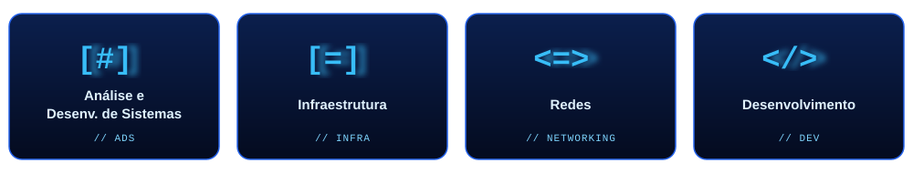

<div align="center">



<br/>


</div>


## `> about_me`

```text
Estudante de Análise e Desenvolvimento de Sistemas (Unicesumar), em busca da
primeira oportunidade como Desenvolvedor Júnior.

Construo aplicações com Java e Python, consumo APIs REST/JSON, uso Git para
versionamento e trabalho com SQL (PostgreSQL, MySQL e noções de Oracle),
entendendo bem a integração entre backend e banco de dados. No front-end,
uso HTML e CSS para estruturar interfaces.

```


## `> areas_of_expertise`




## `> tech_stack`

<div align="center">


</div>


## `> certifications`

| Certificação | Instituição | Ano |
| :--- | :--- | :---: |
| Análise e Desenvolvimento de Sistemas | Unicesumar | 2023 – 2026 |
| NLW Connect - Java | Rocketseat | 2025 |


## `> connect_with_me`

<div align="center">

<a href="mailto:brunobelinoferreiira@gmail.com"></a>
<a href="https://www.linkedin.com/in/brunobelino/"></a>

<br/><br/>


<sub>`// end of transmission`</sub>

</div>
